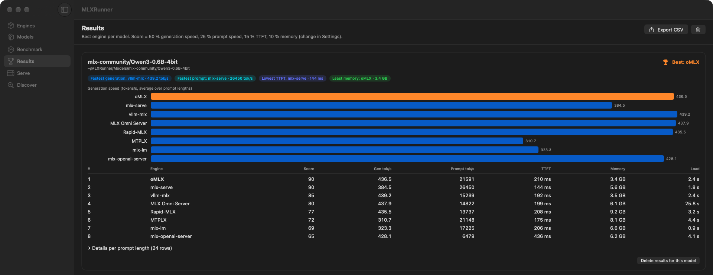
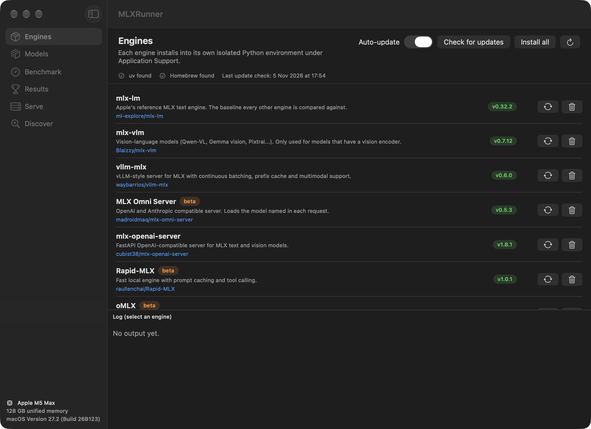
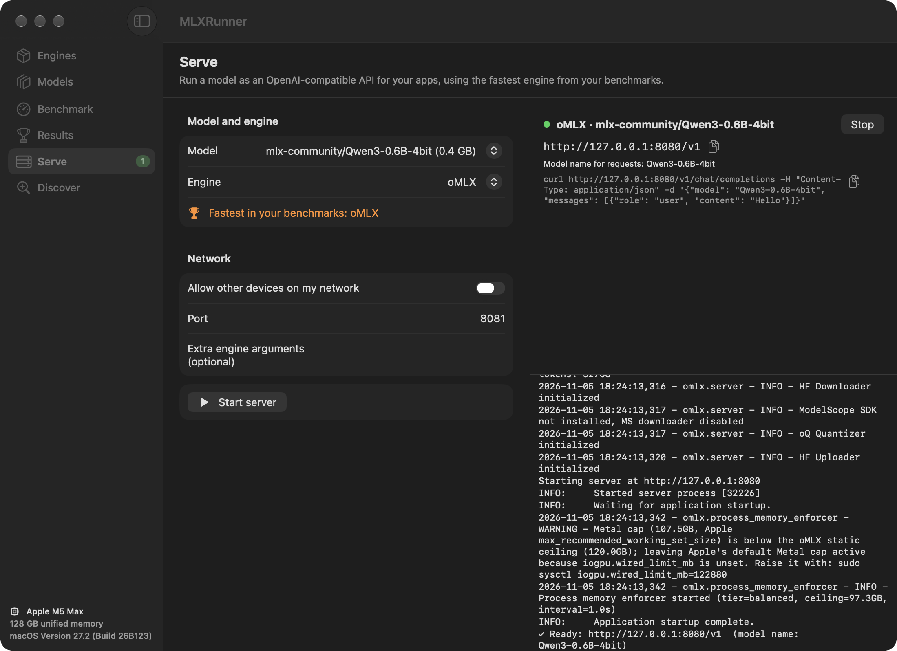

# MLXRunner

**Find the fastest MLX engine for every model on your Mac.**

MLXRunner is a native macOS app for Apple Silicon. It installs the open-source MLX inference engines with one click, benchmarks them against each other on your own models, tells you which engine is fastest for each model, and serves any model as an OpenAI-compatible API.

[](https://github.com/ramirobuisan/mlxrunner/actions/workflows/build.yml)
[](LICENSE)




## Why

There are now about a dozen MLX engines (mlx-lm, vllm-mlx, oMLX, mlx-serve, MTPLX, LM Studio and more). They differ a lot: on the same model one can be twice as fast at reading a long prompt, another uses half the memory, and the winner changes from model to model. MLXRunner runs them all the same way on your machine and gives you a ranking you can act on.

## Features

- **Engines**: one-click install of every engine into its own isolated Python environment (managed with [uv](https://docs.astral.sh/uv/)), or through Homebrew or an app you already have. Engines update automatically once a day. A new version installs next to the old one, and the old one is deleted only after the new one works.
- **Models**: finds the MLX models already on your Mac (MLXRunner folder, Hugging Face cache, LM Studio, mlx-serve) and downloads new ones from Hugging Face, with the size in GB and a "fits in memory" hint.
- **Benchmark**: launches each engine as a server, sends identical streamed requests and measures time to first token, prompt speed, generation speed, peak memory and load time.
- **Results**: a ranking per model with a weighted score (you choose the weights), charts and CSV export.
- **Serve**: run any model with any engine on the port you choose, on this Mac or on your local network. The benchmark winner is preselected.
- **Discover**: searches GitHub for new MLX engines and lets you add one as a custom engine.

| Engines | Serve |
|---|---|
|  |  |

## Install

You need an Apple Silicon Mac (M1 or newer) with macOS 15 or newer.

### Option 1: download the app

1. Download `MLXRunner.zip` from the [latest release](https://github.com/ramirobuisan/mlxrunner/releases/latest).
2. Double-click the zip, then drag `MLXRunner.app` into your **Applications** folder.
3. The app is not notarized by Apple, so macOS blocks the first launch. Open **Terminal** and run:

   ```sh
   xattr -dr com.apple.quarantine /Applications/MLXRunner.app
   open /Applications/MLXRunner.app
   ```

### Option 2: build from source

You also need Xcode 16 or newer and [Homebrew](https://brew.sh). Open **Terminal** and run:

```sh
git clone https://github.com/ramirobuisan/mlxrunner.git ~/Developer/MLXRunner
cd ~/Developer/MLXRunner
./scripts/build.sh --install
open /Applications/MLXRunner.app
```

`build.sh` installs [XcodeGen](https://github.com/yonaskolb/XcodeGen) if it is missing, generates the Xcode project and builds a Release app. Without `--install` the app stays in `build/MLXRunner.app`.

To update later, run `git pull && ./scripts/build.sh --install` in the same folder.

## Quick start

1. **Engines**: press **Install all**. Each engine needs between 0.4 and 2 GB of disk, about 10 GB for all of them.
2. **Models**: open **Download**, search for a model such as `mlx-community/Qwen3-0.6B-4bit` and download it, or use one you already have.
3. **Benchmark**: pick models and engines, then press **Run benchmark**. A small model takes a few minutes; a 30B model can take 20 minutes or more.
4. **Results**: see the ranking and the best engine for each model.
5. **Serve**: start the winner as an OpenAI-compatible server and point your apps at `http://localhost:8080/v1`.

## Supported engines

| Engine | Installed with | Notes |
|---|---|---|
| [mlx-lm](https://github.com/ml-explore/mlx-lm) | uv | Apple's reference engine, the baseline |
| [mlx-vlm](https://github.com/Blaizzy/mlx-vlm) | uv | vision models only |
| [vllm-mlx](https://github.com/waybarrios/vllm-mlx) | uv | continuous batching, prefix cache |
| [MLX Omni Server](https://github.com/madroidmaq/mlx-omni-server) | uv | beta |
| [mlx-openai-server](https://github.com/cubist38/mlx-openai-server) | uv | text and vision |
| [Rapid-MLX](https://github.com/raullenchai/Rapid-MLX) | uv | beta |
| [oMLX](https://github.com/jundot/omlx) | uv, from Git | beta, updates tracked by commit, SSD KV cache |
| [MTPLX](https://github.com/youssofal/MTPLX) | uv | multi-token prediction |
| [mlx-serve](https://github.com/ddalcu/mlx-serve) | Homebrew or existing binary | native, no Python |
| [LM Studio](https://lmstudio.ai) (mlx-engine) | the LM Studio app | uses `lms`; models in `~/.lmstudio/models` |

Every engine is described by a short recipe in [`MLXRunner/Resources/engines.json`](MLXRunner/Resources/engines.json). To add one, see [CONTRIBUTING.md](CONTRIBUTING.md#adding-an-engine), or add it from the **Discover** tab without changing any code.

## How the benchmark works

Every engine is started as an OpenAI-compatible server, one at a time, with a cool-down in between. MLXRunner then sends the same streamed `/v1/chat/completions` requests to each one:

- **Prompt lengths**: 512, 2,048 and 8,192 tokens by default, each followed by 256 generated tokens.
- **Fair prompts**: every prompt starts with a random nonce, so no engine can answer from a prompt cache. A 1,024-token warm-up request also calibrates the prompt length to each model's tokenizer.
- **Same settings everywhere**: temperature 0, thinking turned off where the model supports it, and end-of-sequence ignored where the engine allows it, so every engine generates the same number of tokens.
- **Repeats**: 3 measured runs per prompt length; the median is kept.

| Metric | How it is measured |
|---|---|
| Time to first token (TTFT) | request sent → first streamed token |
| Prompt speed | prompt tokens ÷ TTFT |
| Generation speed | (output tokens − 1) ÷ (last token − first token) |
| Peak memory | increase of the Mac's used memory during the run, plus the engine's own process footprint |
| Load time | engine launch → first token of the first request |

The score combines the averages over prompt lengths: 50 % generation speed, 25 % prompt speed, 15 % TTFT and 10 % memory by default. Change the weights in **MLXRunner → Settings**.

### Example

Qwen3-0.6B-4bit on a MacBook Pro M5 Max with 128 GB (your numbers will differ):

| # | Engine | Score | Generation (tokens/s) | Prompt (tokens/s) | TTFT | Memory |
|---|---|---|---|---|---|---|
| 1 | oMLX | 90 | 436.5 | 21,591 | 210 ms | 3.4 GB |
| 2 | mlx-serve | 90 | 384.5 | 26,450 | 144 ms | 5.6 GB |
| 3 | vllm-mlx | 85 | 439.2 | 15,239 | 192 ms | 3.5 GB |
| 4 | MLX Omni Server | 80 | 437.9 | 14,822 | 199 ms | 6.1 GB |
| 5 | Rapid-MLX | 77 | 435.5 | 13,737 | 208 ms | 9.2 GB |
| 6 | MTPLX | 72 | 310.7 | 21,148 | 175 ms | 8.1 GB |
| 7 | mlx-lm | 69 | 323.3 | 17,225 | 206 ms | 6.6 GB |
| 8 | mlx-openai-server | 65 | 428.1 | 6,479 | 436 ms | 6.2 GB |

### Tips for fair numbers

- Plug in the charger and close heavy apps.
- Compare engines in the same run, on the same day.
- Engines with speculative decoding or multi-token prediction (MTPLX, mlx-serve) can be much faster on models that ship MTP heads. That is a real advantage, not a measurement error.

## Where things are stored

| What | Where |
|---|---|
| Engines | `~/Library/Application Support/MLXRunner/Engines/<engine>/env-<date>/` |
| Benchmark results | `~/Library/Application Support/MLXRunner/results.json` |
| Custom engines | `~/Library/Application Support/MLXRunner/custom-engines.json` |
| Downloaded models | `~/MLXRunner/Models/<org>/<model>` (change it in Settings) |

Some engines keep their own caches. For example oMLX stores a KV cache on disk in `~/.omlx/cache`.

### Uninstall

Quit MLXRunner, then run in **Terminal**:

```sh
rm -rf /Applications/MLXRunner.app "$HOME/Library/Application Support/MLXRunner"
defaults delete com.ramirobuisan.MLXRunner
```

Downloaded models in `~/MLXRunner/Models` are kept; delete that folder too if you don't need them. mlx-serve, if MLXRunner installed it, is removed with `brew uninstall mlx-serve`.

## Privacy

MLXRunner has no analytics and no account. It only connects to:

- PyPI, GitHub and Homebrew, to install and update engines;
- Hugging Face, to search and download models;
- the engine servers it starts on your own Mac.

It also asks every engine to turn off its telemetry (`DO_NOT_TRACK=1`, `HF_HUB_DISABLE_TELEMETRY=1`). Servers listen on `127.0.0.1` only, unless you turn on **Allow other devices on my network** in Serve.

The optional Hugging Face token (only needed for gated models) is stored in the app's preferences, or read from `~/.cache/huggingface/token` if you have used `hf auth login`.

## Contributing

Bug reports, new engines and pull requests are welcome. Start with [CONTRIBUTING.md](CONTRIBUTING.md). Benchmark results from other Macs are especially useful: export the CSV from **Results** and attach it to an issue.

## License

[MIT](LICENSE). MLXRunner is not affiliated with Apple, Hugging Face, LM Studio or any of the engine projects. Each engine has its own license.
